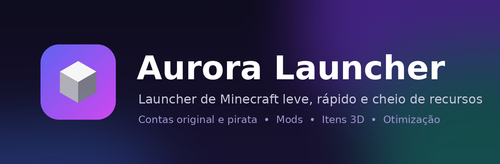

  

  

  
  
  

---

## O que é

O **Aurora Launcher** é um launcher de Minecraft feito para ser leve, rápido e fácil de usar. Ele baixa o jogo, o Java e os mods sozinho. Você só escolhe a versão e clica em **Jogar**.

## Recursos

- 🎮 **Todas as versões** do Minecraft, das antigas às mais novas, com Fabric, Forge, NeoForge e Quilt
- 👤 **Conta original (Microsoft) e conta pirata**, trocando entre elas em um clique
- 📦 **Instâncias separadas**: cada uma com seus próprios mods, mundos e configurações
- 🧩 **Gerenciador de mods** com busca no Modrinth, atualização e editor de configurações
- 🚀 **Otimização automática** para PC fraco: mods de desempenho e ajustes de memória e Java
- 🦋 **Itens 3D exclusivos**: asas que batem, auréolas, chapéus e pets que flutuam ao seu lado
- 👕 **Guarda-roupa de skins e capas**, editor de personagem e galeria para compartilhar skins
- ☕ **Java automático**: baixa a versão certa para cada versão do jogo
- 🔄 **Atualização automática**: quando sai versão nova, o launcher avisa e se atualiza sozinho

## Como instalar

1. Clique em **Baixar Aurora Launcher** no topo da página.
2. Em **Assets**, baixe o `AuroraLauncher_..._x64-setup.exe` (instalador) ou o `..._portable.exe` (abre sem instalar).
3. Abra o arquivo. Se o Windows mostrar *"O Windows protegeu o computador"*, clique em **Mais informações → Executar assim mesmo**. O aviso aparece porque o launcher é novo e ainda não tem assinatura paga da Microsoft.

## Requisitos

| | Mínimo |
|---|---|
| Sistema | Windows 10 ou 11 (64 bits) |
| Memória | 4 GB de RAM |
| Internet | Necessária na primeira vez de cada versão |

## Perguntas frequentes

**Os itens 3D aparecem para os outros jogadores?**
Sim, para quem também usa o Aurora Launcher. No Minecraft comum eles não aparecem.

**Preciso ter Java instalado?**
Não. O launcher baixa a versão certa sozinho.

---

Aurora Launcher não é afiliado à Mojang ou à Microsoft. Minecraft é marca da Mojang AB.

